<p align="center"><i>A self-hosted knowledge workspace for small teams. Upload PDFs, Word files, Markdown, CSV and text, then ask questions and get answers that cite the passages they came from. Every search is limited to what the person asking is allowed to open.</i></p>

<a id="whats-inside"></a>


<details>
<summary>read as text</summary>

- **Retrieval:** sentence-aware chunking, `all-MiniLM-L6-v2` embeddings and FAISS search, reranked with keyword overlap.
- **Answers:** a local model through Ollama, streamed token by token. If no model is running, Infera quotes the best matching passages instead.
- **Access control:** four workspace roles plus owner, editor and viewer roles inside each project. It is enforced on every API call and on every retrieval.
- **Collaboration:** projects, nested folders, notes with Markdown preview, direct messages, presence, and an audit log.

</details>

<a id="how-it-works"></a>




<a id="quick-start"></a>


Requirements: Python 3.11+, Node 20+. Ollama is optional.

```bash
# Backend
cd backend
python -m venv venv
venv\Scripts\activate          # macOS/Linux: source venv/bin/activate
pip install -r requirements.txt
copy .env.example .env         # macOS/Linux: cp .env.example .env
python manage.py migrate
python manage.py seed_demo     # demo people, projects and documents
python manage.py runserver

# Frontend (second terminal)
cd frontend
npm install
npm run dev
```

Open http://localhost:5173 and sign in as `ananya` (Founder), `tomas` (HR), `wei` (PM) or `ifeoma` (Employee). The password for all of them is `infera-demo-2026`.

To get written answers instead of quoted passages, install [Ollama](https://ollama.com) and run `ollama pull mistral`. The status dot in the sidebar turns green when a model is available.

<a id="roles"></a>


| | Founder | HR | PM | Employee |
|---|:-:|:-:|:-:|:-:|
| See every project and document | ✓ | | | |
| Create projects | ✓ | | ✓ | |
| Add people to the workspace | ✓ | ✓ | | |
| Change roles, deactivate people | ✓ | | | |
| Read everyone's audit log | ✓ | | | |

Everyone else sees projects they belong to, plus a private personal space. Personal notes stay private to their author, including from the Founder. Inside a project, owners and editors can add files; viewers can only read and ask questions.

<a id="useful-commands"></a>


```bash
python manage.py test workspace        # backend test suite
python manage.py reindex               # rebuild the vector index from the database
python manage.py reindex --failed-only # retry files that failed to index
npm run typecheck                      # frontend type check
npm run build                          # production build
```

<a id="configuration"></a>


All settings are environment variables; see `backend/.env.example`. The important ones:

- `DJANGO_DEBUG`: defaults to `False`. The example file turns it on for local development.
- `DJANGO_SECRET_KEY`: required whenever debug is off; the server refuses to start without it.
- `LLM_PROVIDER`: `auto` (default) uses Ollama when it is reachable and passage quoting otherwise. `gemini` is opt-in only, because it sends retrieved text to Google.
- `DJANGO_ALLOWED_HOSTS`, `CORS_ALLOWED_ORIGINS`, `CSRF_TRUSTED_ORIGINS`: the hostnames the API and the frontend are served from.

The frontend reads `VITE_API_URL` at build time (see `frontend/.env.example`).

Uploaded files are served only through an authenticated download endpoint, never as public media URLs.

<a id="deploying"></a>


1. Set `DJANGO_DEBUG=False`, a long random `DJANGO_SECRET_KEY`, and your real hostnames in `backend/.env`.
2. Behind HTTPS, also set `SECURE_SSL_REDIRECT=True`, `SECURE_HSTS_SECONDS` and, if a proxy terminates TLS, `USE_X_FORWARDED_PROTO=True`.
3. Run `python manage.py check --deploy`, `migrate` and `collectstatic`, then serve `core.wsgi` with a WSGI server such as gunicorn or waitress.
4. Build the frontend with `VITE_API_URL` pointing at the API and serve `frontend/dist` as static files, falling back to `index.html` for client-side routes.

In production the API returns JSON only (the browsable API is disabled), cookies are marked secure, and responses carry `nosniff`, `same-origin` referrer and `DENY` framing headers.

<a id="project-layout"></a>


```
backend/
  accounts/     users, roles, sign-in, team management
  workspace/    projects, folders, documents, notes, chat, messages, audit log
    access.py   every visibility and permission rule in one place
  utils/        extraction, chunking, embeddings, vector store, LLM providers
frontend/src/
  pages/        one file per screen, plus the landing page
  components/   ui/ primitives, app/ shell, chat/, landing/ (GSAP scroll scenes)
  hooks/        React Query data hooks
```


